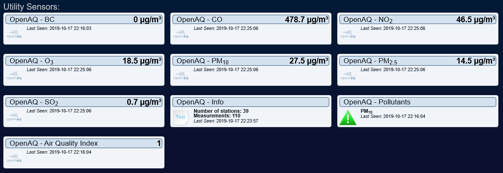

# OpenAQ Air Quality Plugin for Domoticz

**Version 4.2**

A Domoticz Python plugin that reads the latest air-quality measurements for one or more monitoring stations from [OpenAQ](https://openaq.org) (API v3) and exposes them as native Domoticz devices. The plugin is read-only: it only ever sends `GET` requests.

OpenAQ aggregates PM<sub>2.5</sub>, PM<sub>10</sub>, ozone (O<sub>3</sub>), sulfur dioxide (SO<sub>2</sub>), nitrogen dioxide (NO<sub>2</sub>), carbon monoxide (CO) and black carbon (BC) from real-time government and research-grade sources.

With special recognition to Xorfor for creating this plugin, and to waltervl for its evolution. From v3.1 an OpenAQ API key is required; v4.0 moved the plugin to OpenAQ API v3; v4.2 added support for several stations.

## Supported versions

| Version | Supported |
|---|---|
| 4.2.x | Yes. Current version. |
| 4.1.x | Yes. Still supported; upgrading to 4.2 is recommended. |
| 4.0 and earlier | No. Upgrade to 4.2. |

Support for versions before 4.2 will end in a future release, and from then on only 4.2 and later are supported. Plan your upgrade to 4.2 now; it needs no other action than updating the plugin (see [Upgrading](#upgrading)). Details are in [`SECURITY.md`](SECURITY.md) and [`ROADMAP.md`](ROADMAP.md).

## Highlights

- Uses **OpenAQ API v3**. The v1/v2 endpoints were retired by OpenAQ on 2025-01-31 and now answer HTTP 410 Gone.
- **One or more stations per hardware instance** (up to 20): a comma-separated list of **Location IDs**, or an automatic lookup of up to *Max auto-detected stations* locations near your Domoticz coordinates, nearest first. A station is what OpenAQ calls a location.
- **Stable devices.** Every station owns a block of ten devices. A station always finds its own devices again, whatever the order of the list, a temporary failure or a removed ID, so history never ends up on another station's devices.
- Seven pollutant sensors per station (BC, CO, NO<sub>2</sub>, O<sub>3</sub>, PM<sub>10</sub>, PM<sub>2.5</sub>, SO<sub>2</sub>), shown with the unit OpenAQ reports.
- An **Air Quality Index** (0–4) and a native Domoticz **Alert** device (gray, green, yellow, orange, red) per station, based on the [airqualitynow.eu](http://www.airqualitynow.eu/about_indices_definition.php) limits.
- An **Info** text device per station with the location ID and the number of sensors reporting.
- **Secrets stay out of the log.** The API-key field is masked in the Domoticz hardware form, and neither the key nor your Domoticz location is written to the log, not even with Debug on.
- A station that cannot be set up is skipped and reported while the others run. A failed start leaves the plugin idle with a clear message instead of an error on every heartbeat.
- Polls each station once per hour, far below OpenAQ's free-tier limits (60 requests/minute, 2,000/hour).
- Python standard library only; no `pip install` and no third-party runtime dependencies.

## Requirements

- Domoticz with Python plugin support.
- Python 3 (the interpreter used by Domoticz).
- An OpenAQ API key (free). Create an account at <https://explore.openaq.org/register>; the key is shown, and can be rotated, at <https://explore.openaq.org/account>.
- Network access from the Domoticz host to `api.openaq.org` on port 443 (HTTPS).
- At least one OpenAQ location near you. Check <https://explore.openaq.org> to see whether a source exists at your location, and to find location IDs.
- Your position set in Domoticz under **Setup → Settings → System → Location**, but only if you leave the Location IDs blank (see [Choosing locations](#choosing-locations)).

## Installation

Clone the repository into the Domoticz `plugins` directory:

```bash
cd <domoticz>/plugins
git clone https://github.com/janreimen/Domoticz-OpenAQ-Plugin.git
```

The directory must contain `plugin.py` and `xfr_openaq2.zip` (the device icons). Restart Domoticz after installing or updating the plugin. See [`DEPLOY.md`](DEPLOY.md) for permissions, Docker, updating, rollback and troubleshooting.

### Upgrading

Upgrading from 4.1 (or 4.0) needs no other action. The plugin key is unchanged, so your hardware instance keeps its settings, and the devices keep their unit numbers and history.

- A single Location ID in the field is a list of one: the station keeps units 1–10 exactly as before.
- In an instance that uses the automatic lookup, **Max auto-detected stations** is empty until you save the hardware page, and an empty field means 1, which is what 4.1 did. The plugin keeps the station it already uses, so no devices are added. Enter a number if you want more stations.
- The **Location ID** field is now called **OpenAQ Location IDs**, and the **API-KEY** field is masked (since 4.1).

To go back to 4.1, see [`DEPLOY.md`](DEPLOY.md).

## Configure the Domoticz hardware

Add a new hardware instance of type **OpenAQ 4** under **Setup → Hardware**.

| Field | Description |
|---|---|
| Radius (km, max 25, used only if Location IDs is blank) | Search radius for the one-time lookup of nearby locations. Default `10`. Decimals are accepted (`2.5` or `2,5`). A value above OpenAQ's maximum of 25 km is reduced to 25; an empty, non-numeric or non-positive value uses `10`. The radius used is written to the log. |
| OpenAQ API-KEY | Required. Your key from <https://explore.openaq.org/account>. The field is masked. The key is sent in the `X-API-Key` header, only to `api.openaq.org`. |
| OpenAQ Location IDs, comma separated (blank = auto-detect) | Comma-separated list of OpenAQ location (station) IDs, for example `9645,1140`; a single ID such as `9645` (Beidweiler, LU) works as before. At most 20. Leave blank to auto-detect the nearest station(s) using your Domoticz location and the radius. Find IDs at <https://explore.openaq.org> or in the log of an automatic lookup. |
| Max auto-detected stations | How many nearby stations to auto-detect when Location IDs is left blank. Default `3`, at most 20; a value that is not a positive whole number uses `3`. An empty field means `1` (see [Upgrading](#upgrading)). Ignored if Location IDs is set. |
| Debug | `True` or `False` (default). Debug logging is verbose. The API key and your location are masked in it, but review a log before sharing it; see [`SECURITY.md`](SECURITY.md). |

The plugin uses the latitude and longitude from **Setup → Settings → System → Location** only for the automatic lookup. With Location IDs entered, the Domoticz location is not read at all.

### Choosing locations

**With Location IDs entered**, the plugin reads exactly those stations and nothing else. Entries are separated by commas; spaces are ignored. An entry that is not a positive whole number is ignored and reported, a duplicate is used once, and entries after the 20th are ignored and reported. The plugin starts if at least one station can be set up.

**With the field blank**, the plugin asks OpenAQ once for the locations within the radius of your Domoticz coordinates, ranks them by distance itself, and uses the nearest *Max auto-detected stations* of them. It logs what it did:

```text
Looking for up to 3 OpenAQ location(s) within 10 km of the Domoticz location
OpenAQ returned 7 location(s); the nearest ones are used.
Auto-detected OpenAQ location 1 of 3: '<name>' (id <id>)
Auto-detected OpenAQ location 2 of 3: '<name>' (id <id>)
Auto-detected OpenAQ location 3 of 3: '<name>' (id <id>)
To keep using the auto-detected location(s), enter <id1>,<id2>,<id3> in the 'OpenAQ Location IDs' hardware field.
```

How the choice is made:

- OpenAQ's API documentation does not state that results are ordered by distance, so the plugin ranks them. It uses the coordinates OpenAQ gives for each location; if they are missing it uses OpenAQ's own `distance` field; if neither is usable it keeps OpenAQ's order and says so in the log (`... without usable distances; the first ones returned are used, which are not necessarily the nearest.`). Coordinates and distances are never written to the log.
- The ranking covers the first 100 locations OpenAQ returns. If there are more within the radius, the log says so; use a smaller radius to rank all of them.
- **Stations that already have devices come first.** Their history carries on even when a nearer station appears later. The log marks them with `, kept because it already has devices`. The remaining places go to the nearest others.
- The choice can still change when your surroundings change. For a predictable result, copy the logged IDs into the **OpenAQ Location IDs** field.

## Device units

Every station owns a block of ten units. The first station uses units 1–10, the second 11–20, and so on, up to units 191–200 for the 20th station.

| Unit in the block | Device | Type | Description |
|---:|---|---|---|
| 1 | BC | Custom sensor | Black carbon |
| 2 | CO | Custom sensor | Carbon monoxide |
| 3 | NO<sub>2</sub> | Custom sensor | Nitrogen dioxide |
| 4 | O<sub>3</sub> | Custom sensor | Ozone |
| 5 | PM<sub>10</sub> | Custom sensor | Particulate matter less than 10 micrometres in diameter |
| 6 | PM<sub>2.5</sub> | Custom sensor | Particulate matter less than 2.5 micrometres in diameter |
| 7 | SO<sub>2</sub> | Custom sensor | Sulfur dioxide |
| 8 | Info | Text | `OpenAQ Location ID: <id>` and `Sensors reporting: <n>/<m>` |
| 9 | Pollutants | Alert (General / Alert) | Overall alert level 0–4 and the pollutants behind it; `No alert` at level 0 |
| 10 | Air Quality Index | Custom sensor | Overall level 0–4 as a number |

For example, the PM<sub>2.5</sub> device is unit 6 for the first station, unit 16 for the second and unit 26 for the third.

The devices of the first station are unchanged since 4.0, and a test guards their definitions, so upgrades keep existing devices and their history.

Domoticz prefixes each device name with the hardware name, as in the screenshot below.



*The screenshot dates from an earlier version of the plugin. Since 4.0 the Info device shows the OpenAQ location ID and the number of sensors reporting instead of the number of stations and measurements.*

### Device names

With one station the names are the plain names above (`PM2.5`, `Info`, …). With several stations every device name gets the station added, for example `PM2.5 (Beidweiler)`. If two stations have the same name, ` #<id>` is added to tell them apart. Names are only set when a device is created; the plugin never renames a device, and you may rename devices in Domoticz freely. Station names are cleaned (no markup, at most 40 characters) because they come from OpenAQ.

### How a station finds its devices again

The position in the list decides nothing. New devices carry a tag with the OpenAQ location ID (the Domoticz *DeviceID* `OAQ<id>-<unit in block>`, for example `OAQ9645-6`). At startup the plugin looks at the existing devices and gives every station the block that carries its ID, and the lowest free block to a station that has none. So:

- Reordering the list, removing an ID or a temporary failure of one station never moves another station onto the wrong devices.
- The devices of 4.0 and 4.1 carry no tag. The plugin recognises their station from the **Info** device (`OpenAQ Location ID: <id>`), which every poll writes, so they stay with their station. Do not edit the text of an Info device. If a legacy block was never updated, it goes to the first station without a block, because it holds no history.
- The block of a station that is no longer used stays reserved for it, with its devices and history untouched, and the log says so at every start (`Units 1-10 belong to OpenAQ location <id>, which is not in use now`). Adding that ID again picks the block up where it ended. To release the block, delete the devices in Domoticz.
- A new station needs a free block. With all 20 blocks in use (including reserved ones) it is skipped and reported.

### How readings are processed

- OpenAQ's `latest` endpoint returns one value per sensor without naming the pollutant. At startup the plugin makes one call to `GET /v3/locations/{id}` per station to learn which sensor measures which pollutant, in which unit, and the name of the station. Sensors for parameters the plugin does not track (for example temperature) are ignored.
- Every station has its own connection and its own readings: values of different stations never mix.
- For each pollutant the reading with the **newest timestamp** wins. Values of **zero or below** (including the `-999` "no data" sentinel) are ignored, so a genuine reading of exactly 0 is not shown.
- Values are shown with one decimal place. The unit label (typically µg/m³) is taken from OpenAQ and applied to the device on every update.
- In **Sensors reporting: n/m**, `n` is the number of pollutant readings that were used and `m` is the total number of readings OpenAQ returned for the location, including parameters the plugin does not track.
- The plugin polls every station about once per hour, one request per station.

## Air Quality Index

The **Pollutants** alert and the **Air Quality Index** device of each station show how the measured values compare with the limits from <http://www.airqualitynow.eu/about_indices_definition.php>. The table gives the upper limit of each band; a value above a limit moves that pollutant into the next band.

| Pollutant | Very low | Low | Medium | High | Very high |
|:---|---:|---:|---:|---:|---:|
| **CO** | 5000 | 7500 | 10000 | 20000 | > 20000 |
| **NO<sub>2</sub>** | 50 | 100 | 200 | 400 | > 400 |
| **O<sub>3</sub>** | 60 | 120 | 180 | 240 | > 240 |
| **PM<sub>10</sub>** | 25 | 50 | 90 | 180 | > 180 |
| **PM<sub>2.5</sub>** | 15 | 30 | 55 | 110 | > 110 |
| **SO<sub>2</sub>** | 50 | 100 | 350 | 500 | > 500 |
| | gray | green | yellow | orange | red |

The level is `0` (Very low, gray) to `4` (Very high, red). The overall level of a station is the highest level reached by any of its pollutants. Black carbon has no limits and never raises the level. There is no combined level across stations.

## Known limitations

- **Nearest location is only as good as OpenAQ's data.** The automatic lookup ranks the first 100 locations OpenAQ returns, by the coordinates or distance OpenAQ provides. See [Choosing locations](#choosing-locations); enter the IDs explicitly if it matters.
- **Startup lookups are not retried.** If OpenAQ or the network is unreachable when the plugin starts (for example when Domoticz boots before the network is up), the plugin logs the error and stays idle, or runs with the stations that could be set up, until the hardware is restarted or updated under **Setup → Hardware**. The remaining lookups are skipped as soon as it is clear that every request will fail (OpenAQ unreachable, key rejected, rate limit). Entering Location IDs saves the location search.
- **At most 20 stations**, including the reserved blocks of stations that are no longer used.
- **No unit conversion.** The limits above are in µg/m³ and are compared with the raw number OpenAQ reports. If a location reports another unit (ppm or ppb, for example), the level is not meaningful.
- **Zero readings are ignored,** as described above.
- **No staleness handling.** If a sensor stops reporting, its last value stays on the device until a newer reading arrives.
- **Pollutants text.** The text lists the pollutants that raised the overall level while the plugin walked its list (BC, CO, NO<sub>2</sub>, O<sub>3</sub>, PM<sub>10</sub>, PM<sub>2.5</sub>, SO<sub>2</sub>). A lower-level pollutant can therefore be listed, and a pollutant tied at the top level can be left out. The numeric level is always the true maximum.

Planned and potential work is tracked in [`ROADMAP.md`](ROADMAP.md).

## Troubleshooting

| Log message | Meaning |
|---|---|
| `Unable to read openaq API-KEY from settings` | The API key field is empty. |
| `OpenAQ Location ID '<value>' is not a positive whole number and is ignored` | One entry of the list is not a positive whole number (zero and negative IDs do not exist). The other entries are used. |
| `OpenAQ Location ID <id> is listed more than once; using it once` | Informational. |
| `Too many OpenAQ Location IDs (<n> entered); only the first 20 are used` | At most 20 stations are supported. |
| `No valid OpenAQ Location ID entered` | The field is not blank but holds no usable ID. Enter numbers separated by commas, or leave it blank. |
| `The Domoticz location is not set or not valid` | Only raised for the automatic lookup. Set **Setup → Settings → System → Location**, or enter Location IDs. |
| `Radius '<value>' is not a positive number; using the default of 10 km` | Informational. The radius field is not a positive number. |
| `Radius is empty; using the default of 10 km` | Informational. |
| `Radius <value> km is above the OpenAQ maximum of 25 km; using 25 km` | Informational. OpenAQ accepts at most 25 km. |
| `Max auto-detected stations is empty; using 1` | Informational. An empty field means 1 station. Enter a number to detect more. |
| `Max auto-detected stations '<value>' is not a positive whole number; using the default of 3` | Informational. |
| `Max auto-detected stations <n> is above the maximum of 20; using 20` | Informational. |
| `No OpenAQ location found within <n> km of the Domoticz location` | Nothing found within the radius, or the lookup failed (see the preceding error). Increase the radius (up to 25 km) or enter Location IDs. |
| `OpenAQ returned a location without an ID` | OpenAQ's answer was unusable. Enter Location IDs. |
| `OpenAQ request <path> returned HTTP <status>` | OpenAQ rejected a startup request. Check the API key and the Location ID. |
| `OpenAQ request <path> failed: <error>` | Network, DNS, TLS or timeout problem between Domoticz and `api.openaq.org`. |
| `Could not fetch sensor list for OpenAQ location <id>` | The lookup of that station failed. Check the ID and look for an earlier error. |
| `Location <id> returned no usable sensors` | The location has no sensors the plugin can read. Pick another location. |
| `Skipping the remaining <n> OpenAQ location(s): <reason>` | A request showed that every further request would fail as well: OpenAQ could not be reached, the API key was rejected (HTTP 401 or 403), or the rate limit was reached (HTTP 429). The remaining stations are not tried. |
| `No free slot for OpenAQ location <id>` | All 20 station blocks are in use. Delete the devices of a station you no longer use in Domoticz to free its block. |
| `Units <a>-<b> belong to OpenAQ location <id>, which is not in use now` | Informational. That block's devices are left unchanged and keep their history; add the ID again to continue them. |
| `OpenAQ started with <k> of <n> stations` | Some stations could not be set up (the message lists them, and the errors before it say why). The others run. Restart the hardware to try again. |
| `OpenAQ plugin not started` | No station could be set up, or the settings are invalid. The plugin stays idle until the hardware is restarted or updated. |
| `openaq_<id> returned HTTP 410 Gone` | OpenAQ retired an API path this plugin version uses. Update the plugin. |
| `openaq_<id> returned a status: <status>` | OpenAQ answered the hourly poll of that station with an error, for example 429 (rate limit reached). Wait for the next period. |

More detail is in [`DEPLOY.md`](DEPLOY.md).

## Development and tests

The project has a test suite in `tests.py`. It needs neither Domoticz nor network access: the Domoticz plugin API is replaced by an in-memory fake and all HTTP calls are mocked. Besides the plugin behaviour, it checks that the API key and your location never reach the log, that the devices of the first station are unchanged, that a station always finds its own devices again, and that the log messages quoted in these docs still exist in `plugin.py`.

```bash
python3 tests.py
```

For a basic syntax check:

```bash
python3 -m py_compile plugin.py tests.py
```

See [`CONTRIBUTING.md`](CONTRIBUTING.md) for the contribution workflow.

## Release checklist

Before publishing a release:

```bash
python3 tests.py
git status --short --ignored
git add .
git commit -m "Release <VERSION>"
git tag -a <VERSION> -m "Release <VERSION>"
```

Then push the actual branch and tag:

```bash
git push origin <branch>
git push origin <VERSION>
```

Check the branch with `git branch --show-current` instead of assuming `master` or `main`. Update the version in `plugin.py`, `README.md`, `CHANGELOG.md`, `SECURITY.md` and `ROADMAP.md` together; `tests.py` checks that they agree. Release tags are plain numeric, for example `v4.2` (see [`CHANGELOG.md`](CHANGELOG.md)).

## Documentation

| File | Contents |
|---|---|
| [`CHANGELOG.md`](CHANGELOG.md) | Release history |
| [`ROADMAP.md`](ROADMAP.md) | Planned and potential work, and the support policy |
| [`DEPLOY.md`](DEPLOY.md) | Installation, update, rollback and troubleshooting |
| [`CONTRIBUTING.md`](CONTRIBUTING.md) | How to report problems and contribute |
| [`SECURITY.md`](SECURITY.md) | Supported versions, vulnerability reporting and secret handling |
| [`.github/CODE_OF_CONDUCT.md`](.github/CODE_OF_CONDUCT.md) | Community standards |

## Security

See [`SECURITY.md`](SECURITY.md) for vulnerability reporting and API-key handling.

## License

MIT License. See [`LICENSE`](LICENSE).

## Data and credits

Air-quality data is provided by [OpenAQ](https://openaq.org) and its data providers; check the OpenAQ terms and the licence of each data source before reusing the data. Plugin originally created by Xorfor, extended by waltervl, and maintained by Jan Reimen (janreimen).

OpenAQ API documentation: <https://docs.openaq.org>
